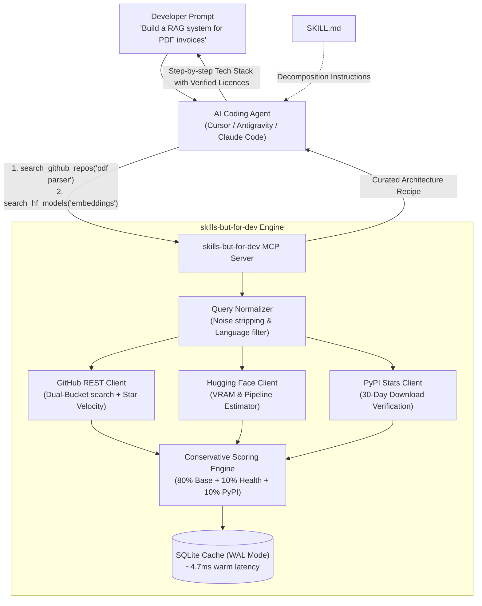

# skills-but-for-dev

<p align="center">
  <strong>Intelligent technology stack and open-source curator for AI coding agents.</strong><br>
  <em>Never let your AI agent build production code on abandoned 2022 libraries.</em>
</p>

<p align="center">
  <a href="https://pypi.org/project/skills-but-for-dev/"></a>
  <a href="https://github.com/MelihcanTheGreat/Skills-but-for-dev/actions/workflows/ci.yml"></a>
  <a href="https://pypi.org/project/skills-but-for-dev/"></a>
  <a href="LICENSE"></a>
  <a href="https://www.python.org/downloads/"></a>
</p>

---

## ⚡ The Problem: LLM Knowledge Cutoff & Dead Repositories

When you ask Cursor, Claude Code, Antigravity, or Copilot:  
> *"Build an AI meeting assistant that records audio, separates speakers, and generates summaries"*

The model immediately starts writing code using libraries from its **static pre-training data**. Meanwhile:
- 💀 **High-star repos might be dead:** A project with 35,000 stars might have had zero commits in 18 months.
- 🚀 **Breakout libraries remain invisible:** The state-of-the-art voice model or fast audio engine released last month doesn't exist in the LLM's weights.
- ⚖️ **Hidden licensing traps:** Generating code that imports `GPL-3.0` or `CC-BY-NC-4.0` libraries can create major intellectual property and commercial liabilities.
- 💥 **VRAM crashes:** AI agents frequently recommend 14B parameter models on a local machine with only 8 GB of VRAM.

**`skills-but-for-dev` fixes this.** It acts as an autonomous pre-flight curator for your agent, querying live GitHub velocity, PyPI monthly adoption, and Hugging Face VRAM requirements **before** writing code.

---

## 🥊 Before & After

| Task: *"Build a local meeting notes agent"* | ❌ Vanilla AI Agent (Without `skills-but-for-dev`) | ✅ AI Agent + `skills-but-for-dev` |
|:---|:---|:---|
| **Transcription (ASR)** | Suggests `SpeechRecognition` (deprecated Python 2 era wrapper) | **`Systran/faster-whisper`** (9.6M/mo PyPI downloads, 4x faster CTranslate2) |
| **Speaker Diarization** | Tries to hand-code clustering or hallucinates non-existent APIs | **`modelscope/FunASR`** / **`pyannote.audio`** (Verified active acceleration: $v_4 / v_{12} = 1.2$) |
| **Licensing** | Generates code importing `GPL` / non-commercial packages | **100% Permissive Verification** (Flags MIT / Apache-2.0, filters restrictive licenses) |
| **Local Hardware Check** | Recommends large Whisper model, crashing local GPU | **Automatic VRAM Baseline** (Estimates 0.54 GB FP16 ceiling for `faster-whisper-small`) |

---

## 🛠️ Key Capabilities

* **Dual-Bucket Candidate Retrieval:** Discovers proven industry leaders (`stars:>500`) alongside fast-rising breakout repositories (`stars:75..3500`, pushed $< 30$ days) without cannibalization.
* **Real-World PyPI Production Adoption:** Fetches real monthly download statistics via `pypistats.org` to protect against star-inflation and GitHub bots.
* **Real-Time Star Velocity & Acceleration:** Calculates 4-week moving average ($v_4$) and acceleration ratio ($v_4 / v_{12}$) in a single request.
* **Dormant Spike Anomaly Detection:** Flags suspicious repositories that were inactive for 6+ months and suddenly spiked in stars over a single week.
* **Hardware VRAM Estimator:** Accurate minimum VRAM baseline calculation across `.safetensors`, sharded model weights, Diffusers pipelines, and distinct GGUF quantization levels (`Q4_K_M`, `Q8_0`).
* **Zero-Config GitHub Token Auto-Discovery:** Seamlessly discovers existing GitHub CLI logins (`gh auth token`) or falls back to an adaptive, quota-conserving unauthenticated mode.
* **Anti-Prompt-Injection Sanitizer:** Strips malicious hidden markdown instructions, zero-width tags, and bloated YAML headers before context reaches your LLM.
* **Sub-5ms SQLite WAL Cache:** Deterministic, persistent local cache with automatic TTL expiration.

---

## 📋 Architecture & Data Flow



---

## 🚀 Quickstart

### 1. Run Instantly with `uvx` (Zero Installation)

No cloning or virtual environment setup required. Works with any MCP-compatible client:

```bash
# Verify it runs and check diagnostics
uvx skills-but-for-dev ping
```

### 2. Configure in Your IDE

#### 🔹 Cursor (`.cursor/mcp.json`)
```json
{
  "mcpServers": {
    "skills-but-for-dev": {
      "command": "uvx",
      "args": ["skills-but-for-dev"],
      "env": {
        "GITHUB_TOKEN": "optional_your_pat_here"
      }
    }
  }
}
```

#### 🔹 Antigravity / Gemini (`mcp_config.json`)
```json
{
  "mcpServers": {
    "skills-but-for-dev": {
      "command": "uvx",
      "args": ["skills-but-for-dev"]
    }
  }
}
```

#### 🔹 Claude Desktop (`claude_desktop_config.json`)
```json
{
  "mcpServers": {
    "skills-but-for-dev": {
      "command": "uvx",
      "args": ["skills-but-for-dev"]
    }
  }
}
```

> **Tip:** If you already use the GitHub CLI (`gh`), `skills-but-for-dev` automatically detects your authentication token via `gh auth token`. You don't even need to configure `GITHUB_TOKEN` manually!

---

## 💡 Example Agent Stack Recipe

When your agent uses `skills-but-for-dev`, it generates structured architecture recipes before writing code:

| Layer | Recommended Component | Star Velocity | Real-World PyPI Adoption | License | Hardware / Memory |
|:---|:---|:---:|:---:|:---:|:---:|
| **ASR (Speech-to-Text)** | [`SYSTRAN/faster-whisper`](https://github.com/SYSTRAN/faster-whisper) | $v_4 = 18.2$/day (accel: 1.15) | **9,614,222** downloads/mo | MIT | ~0.54 GB VRAM (small FP16) |
| **Speaker Diarization** | [`modelscope/FunASR`](https://github.com/modelscope/FunASR) | $v_4 = 8.4$/day (accel: 1.20) | **272,534** downloads/mo | MIT | ~1.2 GB VRAM |
| **Embeddings** | [`sentence-transformers`](https://github.com/UKPLab/sentence-transformers) | $v_4 = 14.1$/day (accel: 1.05) | **22,332,616** downloads/mo | Apache-2.0 | ~0.62 GB VRAM |

---

## ⚡ Performance & Evaluation Benchmarks

Benchmarked across realistic multi-layer agent scenarios using strict Ground Truth matching:

| Metric | Result | Benchmark Details |
|:---|:---:|:---|
| **Warm Cache Latency** | **4.73 ms** | Sub-5 millisecond response time via SQLite WAL mode |
| **Cold API Latency** | **1,728 ms** | Optimized single-flight queries with adaptive quotas |
| **Cache Speedup** | **365.7x** | Massive latency reduction for recurring architecture queries |
| **Commercial License Safety** | **95.2%** | Automatic filtering of GPL / CC-BY-NC restrictive licenses |
| **PyPI Download Signal Rate** | **52.4%** | Over half of returned candidates enriched with production downloads |
| **Unit Test Coverage** | **40 / 40 Passing** | Comprehensive suites for normalizer, PyPI client, cache, and query relaxation |

You can run the evaluation suite locally at any time:
```bash
python evals/run_evals.py
```

---

## 🧰 CLI Tools & Diagnostics

Inspect active tokens, cache paths, and server health directly from your terminal:

```bash
# Print active version
skills-but-for-dev --version

# Ping server and verify token discovery source (ENV vs GitHub CLI)
skills-but-for-dev ping
```

---

## 📖 Architecture Deep Dive

For mathematical formulas (star velocity moving averages, exponential recency decay, dormant spike detection ratios), see [ARCHITECTURE.md](ARCHITECTURE.md).

---

## 📄 License

Distributed under the [Apache License 2.0](LICENSE).
